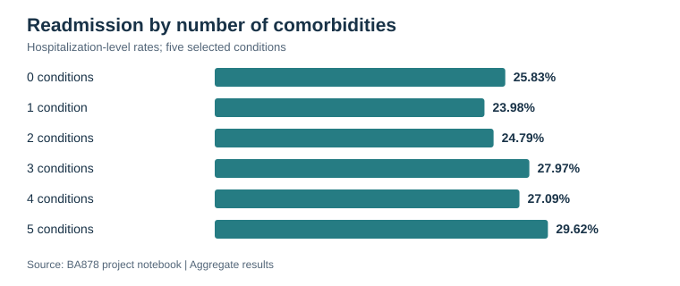
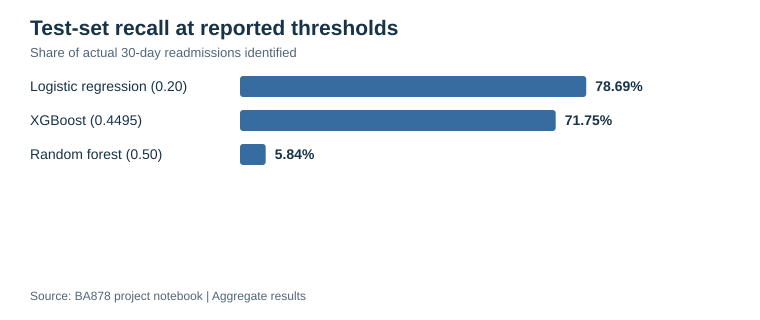

# 30-Day Readmission in Chronic Kidney Disease

**Healthcare Analytics | Predictive Modeling | SQL (BigQuery) | Python**

## Research question

Can machine learning identify CKD patients at risk of hospital readmission within 30 days of discharge, and how is multimorbidity associated with that risk? This academic team project explores how clinical characteristics and prior healthcare utilization could inform discharge planning and follow-up prioritization.

## Dataset

| Hospitalizations | Unique patients | 30-day readmission rate | Predictors |
| ---: | ---: | ---: | ---: |
| 79,483 | 27,826 | 25.76% | 15 |

- **Sources:** MIMIC-IV v3.1 (hospital module) and MIMIC-IV-ED v2.2.
- **Unit of analysis:** One CKD hospitalization; positive outcome if a subsequent hospital admission is recorded within 30 days of discharge.
- **Features:** Age, gender, length of stay, admission characteristics, insurance, marital status, five comorbidity indicators, medication count, and prior hospital/ED utilization within 365 days.

## Methodology

1. **SQL & BigQuery:** Construct the CKD cohort using diagnosis codes, link hospital and ED records, and derive readmission labels and predictors.
2. **Exploratory analysis:** Examine missingness, multimorbidity, demographics and prior healthcare utilization.
3. **Preprocessing:** Use patient-grouped splits to prevent patient overlap (51,524 training, 12,757 validation, 15,202 test hospitalizations). Apply imputation, scaling and one-hot encoding.
4. **Modeling:** Compare logistic regression, XGBoost (class weighting and early stopping), and random forest (grouped cross-validation and grid search). Tune logistic regression and XGBoost decision thresholds on validation data.

## Key findings

- Approximately 72.6% of hospitalizations involved at least two of the five additional comorbidities. Readmission rates generally increased with multimorbidity, though the relationship was not strictly monotonic.
- Heart failure had the highest observed readmission rate among the five selected conditions (27.80%).
- Hospitalizations followed by readmission had approximately twice as many prior admissions on average (2.88 vs. 1.43). Prior admissions were also the most important feature in both tree-based models.

## Model performance

Held-out test results (positive class = 30-day readmission):

| Model | Threshold | AUROC | AUPRC | Precision | Recall | F1 |
| --- | ---: | ---: | ---: | ---: | ---: | ---: |
| Logistic regression | 0.20 | 0.6519 | 0.4056 | 0.3032 | **0.7869** | 0.4377 |
| XGBoost | 0.4495 | 0.6556 | 0.4070 | 0.3224 | 0.7175 | **0.4448** |
| Random forest | 0.50 | **0.6588** | — | **0.6171** | 0.0584 | 0.1068 |

XGBoost achieved the highest F1-score at the reported operating points, while logistic regression identified the largest share of actual readmissions. Random forest achieved the highest AUROC but missed most readmissions at its default threshold; its threshold was not tuned in this notebook.

## Clinical implications & limitations

At a threshold of 0.20, logistic regression identified 3,016 of 3,833 observed readmissions but generated 6,931 false alerts. This illustrates the trade-off between identifying more at-risk patients and the workload associated with unnecessary follow-up. Model discrimination was modest (AUROC approximately 0.65–0.66). Findings are observational, and external validation, calibration, fairness assessment and workflow evaluation are needed before clinical use. Readmissions outside the observed hospital system may not be captured.

## Explore the analysis

- [Project notebook](BA878_Team_Project.ipynb)

**Tools:** Google BigQuery, SQL, Python, pandas, NumPy, scikit-learn, XGBoost, Matplotlib, Google Colab.

## Data access

MIMIC-IV and MIMIC-IV-ED are available through [PhysioNet](https://physionet.org/content/mimiciv/) subject to credentialing and data-use requirements. Reproduction requires authorized access to the prepared BigQuery dataset. The README visuals contain only aggregate statistics.
